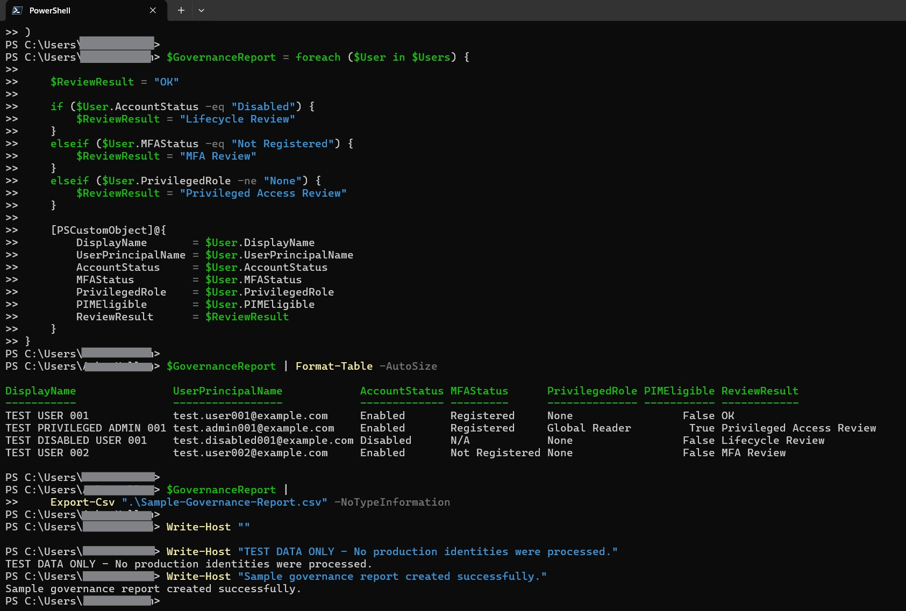

# Microsoft Entra ID Identity Governance Reporting

A PowerShell portfolio project demonstrating automated identity governance review and reporting concepts for Microsoft Entra ID.

> **TEST DATA ONLY**
>
> This repository uses entirely synthetic test identities and sample data. No production tenant, employer, customer, or personally identifiable information (PII) is included.

---

## Overview

This project demonstrates how PowerShell can be used to evaluate identity governance conditions and identify accounts that may require additional access, security, or lifecycle review.

The script processes synthetic identity data, evaluates predefined governance conditions, assigns a review result, displays the results in PowerShell, and exports the completed report to CSV.

---

## What the Script Reviews

- Account status
- Multi-Factor Authentication (MFA) registration
- Privileged role assignments
- Privileged Identity Management (PIM) eligibility
- Identity lifecycle conditions
- Accounts requiring additional governance review

---

## Governance Review Logic

| Condition | Review Result |
|---|---|
| Enabled account with no identified issue | OK |
| Disabled account | Lifecycle Review |
| MFA not registered | MFA Review |
| Privileged role assigned | Privileged Access Review |

---

## Test Identities

All identities are intentionally fictional and clearly labeled as test data:

- `TEST USER 001`
- `TEST USER 002`
- `TEST PRIVILEGED ADMIN 001`
- `TEST DISABLED USER 001`

All sample user principal names use the `example.com` domain.

---

## Example Results

| Test Identity | Account Status | MFA | Privileged Role | PIM Eligible | Review Result |
|---|---|---|---|---|---|
| TEST USER 001 | Enabled | Registered | None | False | OK |
| TEST PRIVILEGED ADMIN 001 | Enabled | Registered | Global Reader | True | Privileged Access Review |
| TEST DISABLED USER 001 | Disabled | N/A | None | False | Lifecycle Review |
| TEST USER 002 | Enabled | Not Registered | None | False | MFA Review |

---

## PowerShell Demonstration

The screenshot below shows the script evaluating the synthetic identities and assigning governance review results.



The script also exports the results to `Sample-Governance-Report.csv`.

---

## Technologies and Concepts

- Microsoft Entra ID
- PowerShell
- Identity Governance
- Identity and Access Management (IAM)
- Privileged Identity Management (PIM)
- Role-Based Access Control (RBAC)
- Multi-Factor Authentication (MFA)
- Privileged Access Review
- Identity Lifecycle Management
- CSV Reporting
- IT Automation

---

## Repository Contents

- `README.md` - Project documentation
- `Get-EntraGovernanceReport.ps1` - PowerShell governance demonstration
- `Sample-Governance-Report.csv` - Sample output generated from synthetic data
- `Test1.jpg` - Screenshot of the demonstration running

---

## Running the Demonstration

### Requirements

- Windows PowerShell or PowerShell 7+
- No Microsoft Entra tenant connection is required
- No production credentials are required

### Run the Script

1. Clone or download the repository.
2. Open PowerShell.
3. Navigate to the repository directory.
4. Run:

```powershell
.\Get-EntraGovernanceReport.ps1
```

The script processes the synthetic identities, evaluates governance conditions, displays the results, and exports `Sample-Governance-Report.csv`.

---

## Privacy and Security

This repository was intentionally designed as a public portfolio demonstration.

It does **not** contain real employee identities, employer or customer information, production tenant or subscription IDs, internal domains or URLs, credentials, API keys, access tokens, authentication secrets, production access reports, or production audit evidence.

All names, email addresses, identities, and report data are synthetic.

---

## Project Purpose

This project demonstrates practical PowerShell automation and Microsoft Entra ID identity governance concepts.

The focus is on converting identity information into repeatable governance checks and actionable reporting:

**Identity Data -> Governance Logic -> Review Classification -> Report**

---

## Current Scope

This version intentionally uses local synthetic data rather than connecting to a live Microsoft Entra ID tenant. This keeps the demonstration safe for public distribution, easy to test, independent of production credentials, and free of employer or customer information.

---

## Future Enhancements

Potential future versions may demonstrate:

- Microsoft Graph PowerShell SDK integration
- Microsoft Entra ID Access Reviews
- Conditional Access reporting
- Additional PIM and privileged-role analysis
- Group membership governance
- Stale account identification
- Guest account review
- Additional identity lifecycle conditions
- HTML or Excel report generation
- Automated governance summary dashboards

---

## Disclaimer

This project is provided for demonstration and educational purposes. The governance conditions shown here are simplified examples and should not be treated as a complete production identity governance or security control framework.


